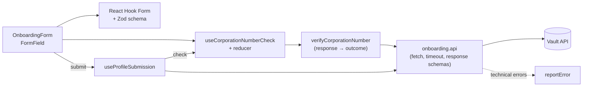

# Onboarding Form

[](https://github.com/o-poliakh/onboarding-assessment/actions/workflows/ci.yml)

Step 1 of a five-step onboarding flow: a profile form whose corporation number is verified against the API on blur, and whose valid details are sent with `POST /profile-details`.

Built with React 19, TypeScript, React Hook Form, Zod and Vite.

## Highlights

- **One typed schema for every rule.** Zod validates the fields, trims the values and produces the data that is sent.
- **Canadian phone numbers only.** `+1` followed by 10 digits, and the number must resolve to Canada (US numbers share `+1`).
- **Race-free async verification.** A custom hook deduplicates requests, ignores stale responses (A → B → A) and reuses the result on submit. A reducer holds the verification state.
- **Defensive API layer.** Every response body is validated at runtime. 10 s timeout. `POST` is never retried automatically.
- **Accessible errors.** Visible labels, `aria-invalid` + `aria-describedby`, focus on the first invalid field, `Error:` prefix in the page title. Submit keeps keyboard focus while it is locked.
- **Observable failures.** An error boundary around the form and a single `reportError` entry point that never sends personal data.
- **Integration-first tests.** Real components, only the network mocked with MSW. Mutation score of about 94% (Stryker).

## Requirements

- Node.js `^22.18.0 || >=24` (developed on 24, see [`.nvmrc`](.nvmrc))
- npm
- A current browser. Safari needs 17.4 or later, for `AbortSignal.any` (request cancellation combined with the timeout).

Node 22.18 or later is required because `scripts/generate-css-module-types.ts` runs as TypeScript directly in Node.

## Getting started

```bash
nvm use        # optional: switch to the Node version from .nvmrc
npm install
npm run dev    # http://localhost:5173
```

No further setup is needed. The API URL is public configuration, so the `.env` file is committed.

## Configuration

| Variable            | File        | Value                                           | Purpose                                  |
| ------------------- | ----------- | ----------------------------------------------- | ---------------------------------------- |
| `VITE_API_BASE_URL` | `.env`      | `https://fe-hometask-api.qa.vault.tryvault.com` | Base URL of the API used by the app      |
| `VITE_API_BASE_URL` | `.env.test` | `https://example.test`                          | Isolated host for tests, answered by MSW |

[`src/config/env.ts`](src/config/env.ts) validates the value at startup. It fails fast with a readable error if the URL is missing or not `http(s)`.

> [!NOTE]
> Tests can never reach the real API. Every request goes to `example.test`, and a request without an MSW handler fails the test.

## Scripts

| Script                    | What it does                                                                    |
| ------------------------- | ------------------------------------------------------------------------------- |
| `npm run dev`             | Start the Vite dev server                                                       |
| `npm run build`           | Type-check and build for production into `dist/`                                |
| `npm run preview`         | Serve the production build locally                                              |
| `npm test`                | Run all tests once (Vitest, a few seconds)                                      |
| `npm run test:watch`      | Run tests in watch mode                                                         |
| `npm run test:coverage`   | Run tests with V8 coverage                                                      |
| `npm run test:mutation`   | Run mutation testing with StrykerJS (about 2 min)                               |
| `npm run lint`            | Lint with Oxlint; warnings fail too                                             |
| `npm run typecheck`       | Generate CSS Module types, then run `tsc -b`                                    |
| `npm run css:types`       | Generate `*.module.d.css.ts`, so a misspelled CSS class fails the type check    |
| `npm run knip`            | Find unused files, exports and dependencies                                     |
| `npm run knip:production` | The same for production code only, so it also lists exports that only tests use |
| `npm run format`          | Format every file with Prettier                                                 |
| `npm run format:check`    | Check formatting without writing                                                |
| `npm run check`           | Every CI gate: typecheck, lint, knip, format:check, test, build                 |

## Project structure

The code is organized **by feature**. Everything the form needs lives in `src/features/onboarding`.

```
src/
├── app/                  Page layout, ErrorBoundary and ErrorFallback around the form
├── config/env.ts         Validated environment configuration
├── observability/        reportError entry point, React root and window error handlers
├── features/onboarding/
│   ├── components/       OnboardingForm (fields, errors, layout), FormField (label, input, error)
│   ├── hooks/            useCorporationNumberCheck (async verification), useProfileSubmission (submit flow), useErrorTitlePrefix
│   ├── model/            Zod form schema, verification state types and reducer
│   ├── api/              API functions, verification outcome mapping, response schemas, ApiError
│   └── __tests__/        Integration and unit tests of the feature
└── test/                 Vitest setup, MSW server and handlers, API fixtures, infrastructure test
scripts/                  CSS Module type generator
docs/decisions.md         Technical notes: architecture, API contract, trade-offs
```

## Architecture



| State                                        | Owner                                           |
| -------------------------------------------- | ----------------------------------------------- |
| Field values, local errors, submitting state | React Hook Form                                 |
| Remote corporation number verification       | `useReducer` inside `useCorporationNumberCheck` |
| Server error from `POST`                     | React Hook Form `errors.root.server`            |
| Success message                              | Local `useState` in `useProfileSubmission`      |

**Submit flow** (`useProfileSubmission`):

1. A synchronous `useRef` guard blocks double submits.
2. The Zod resolver validates every field.
3. The submit awaits the corporation number verification and reuses a request in flight or a stored result.
4. The trimmed data is sent with `POST`.

After a `200`, Submit stays locked until a field changes. It is locked with `aria-disabled`, not `disabled`, so a keyboard user does not lose focus. The API has no idempotency key, so a repeated submit would create a duplicate.

Details: [docs/decisions.md → Architecture](docs/decisions.md#architecture).

## Validation rules

| Field              | Rules                                                                      |
| ------------------ | -------------------------------------------------------------------------- |
| First / last name  | Required, trimmed, at most 50 characters                                   |
| Phone number       | Required, trimmed, `+1` followed by 10 digits, a valid **Canadian** number |
| Corporation number | Required, trimmed, exactly 9 digits, then verified by the API on blur      |

Fields are validated on blur. After a failed submit, errors update while the user types.

## API

Base URL: `VITE_API_BASE_URL`. Every response body the app reads is validated with Zod ([`api/onboarding-response.schemas.ts`](src/features/onboarding/api/onboarding-response.schemas.ts)).

| Endpoint                          | Response                                   | Result in the UI                |
| --------------------------------- | ------------------------------------------ | ------------------------------- |
| `GET /corporation-number/:number` | `200` `{ corporationNumber, valid: true }` | Valid                           |
|                                   | `404` `{ valid: false, message }`          | Server message under the field  |
| `POST /profile-details`           | `200` (no body)                            | Success message                 |
|                                   | `400` `{ message }`                        | Server message above the button |

> [!IMPORTANT]
> An invalid corporation number comes back as `404`, not as a failure. Anything else is a technical error and is shown as a retryable message: a 5xx, an unexpected body, malformed JSON, a network failure or a timeout.

Full contract, timeouts and retries: [docs/decisions.md → API contract](docs/decisions.md#api-contract).

## Testing

```bash
npm test                # all tests
npm run test:coverage   # with coverage
npm run test:mutation   # mutation testing, report in reports/mutation/index.html
```

| Layer                        | Tools                                  | File                                                        |
| ---------------------------- | -------------------------------------- | ----------------------------------------------------------- |
| Form behavior (integration)  | React Testing Library, user-event, MSW | `OnboardingForm.test.tsx`                                   |
| Verification hook contract   | React Testing Library, MSW             | `useCorporationNumberCheck.contract.test.tsx`               |
| Verification hook invariants | Vitest, random sequences               | `useCorporationNumberCheck.model.test.tsx`                  |
| Submit guards                | React Testing Library, MSW             | `useProfileSubmission.test.tsx`                             |
| API layer                    | MSW, fake timers                       | `onboarding.api.test.ts`, `verifyCorporationNumber.test.ts` |
| Validation rules             | Vitest                                 | `onboarding-form.schema.test.ts`                            |
| State transitions            | Vitest                                 | `corporation-number.reducer.test.ts`                        |
| Error boundary               | React Testing Library                  | `App.errors.test.tsx`                                       |
| Error reporting, config      | Vitest                                 | `errorHandlers.test.ts`, `env.test.ts`                      |
| Test infrastructure          | Vitest, MSW                            | `infrastructure.test.ts`                                    |

- **Only the network is mocked.** Fixtures in `src/test/fixtures` are snapshots of real API responses. The hook invariant test is the exception: it replaces one function to control exactly when each request settles.
- **No real-time waits.** Concurrency and the 10 s timeout are tested with fake timers and responses that resolve when the test says so.
- **Behavior, not implementation.** Tests check what the user sees and which requests reach the network.

Details: [docs/decisions.md → Testing](docs/decisions.md#testing).

## CI

[`.github/workflows/ci.yml`](.github/workflows/ci.yml) runs on every push to `main` and on every pull request. It runs `typecheck`, `lint`, `knip`, `format:check`, `test` and `build`. Run `npm run check` to get the same result locally before pushing.

## Assumptions

- The corporation number is digits only. Surrounding spaces are trimmed in every field.
- Toll-free numbers (`+1 800`, `+1 888`, …) are rejected. They are shared by every `+1` country, so they cannot be shown to be Canadian.
- The mockup is followed closely. Its border and error colors are below WCAG contrast and are kept as designed. They are CSS custom properties in [`src/index.css`](src/index.css).
- There is no loading indicator during verification, because the mockup has none.
- "Step 1 of 5" is static text. Only the first step is implemented.

## Known limitations

- The 10 s timeout is a starting value, not a measured SLA.
- Without an idempotency key, a `POST` that timed out cannot be retried safely. The user is asked to check before submitting again.
- The `400` response has no field code, so its message is shown above the button rather than under a field.
- The fixtures reflect the API as observed during development and may drift. Nothing checks them against the real API automatically. In the running app, the Zod response schemas report a changed contract as `invalid_response`.

## What I would do next

- Steps 2–5, with a schema per step, a URL per step and a saved draft.
- An idempotency key for `POST`, agreed with the backend.
- Server errors under the right field, once the `400` response says which field failed.
- A pending state for the corporation number check, announced through `aria-live` and agreed with design.
- Contrast fixes for the input border and the error red, agreed with the designer.
- A real monitoring adapter (for example Sentry) inside `reportError`, plus a measured timeout.
- Playwright tests with axe accessibility checks in CI.
- A scheduled CI job that calls the real API and parses its responses with the same Zod schemas, so a backend change fails a build.
- Pre-commit hooks (Lefthook) and Dependabot, once the project has more contributors.

## Further reading

[docs/decisions.md](docs/decisions.md) covers requirements coverage, architecture details, observability, the full API contract, the testing rules, assumptions and trade-offs.
